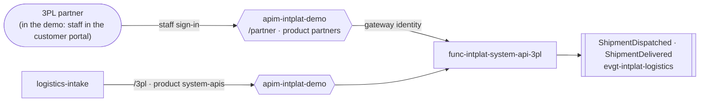

# experience-api-partner

The **[Channel] Partner Experience API**: what the 3PL partner (speedy-3pl) does on the platform. It
sees its bookings (its work list), and reports a pick-up and a delivery. Owned by the **channel team**
([ADR 0017](https://github.com/azure-intelligence-domain/ai-intelligence-domain/blob/main/docs/adr/0017-experience-layer-and-staff-sign-in.md)).

**No code of its own.** The contract is a subset of the
[3PL System API](https://github.com/azure-intelligence-domain/system-api-3pl)'s, and the gateway
serves it under `/partner`, in the product `partners`, calling the 3PL System API's Function with
its own identity. An Experience API that only needs other people at the door, not other data, is
just configuration: no Function, no resource group, no runtime identity.

| Operation | | |
|---|---|---|
| Retrieve List of Shipment Bookings | `GET /shipment-bookings?status=booked` | The partner's work list |
| Retrieve Shipment Booking | `GET /shipment-bookings/{shipmentId}` | |
| Record Pick Up | `POST /shipment-bookings/{shipmentId}/pick-up` | The order is shipped: ShipmentDispatched → OrderShipped |
| Retrieve Shipment | `GET /shipments/{shipmentId}` | |
| Record Delivery | `POST /shipments/{shipmentId}/delivery` | The order is delivered: ShipmentDelivered → OrderDelivered |

In production the partner signs in with its own identity (an Entra app per partner, or a
subscription key per partner). In the demo, staff signed in with Google play the partner through
the [customer portal](https://github.com/azure-intelligence-domain/customer-portal), so the story
can be clicked through on stage.

`.github/workflows/contracts.yml`: the contract check (adidas API guidelines, version, breaking
changes). The platform's pipeline imports the released contract.
